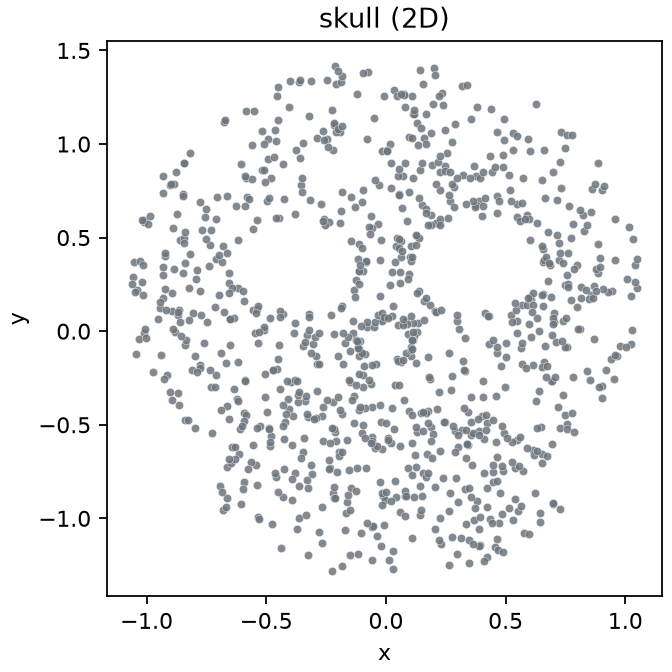
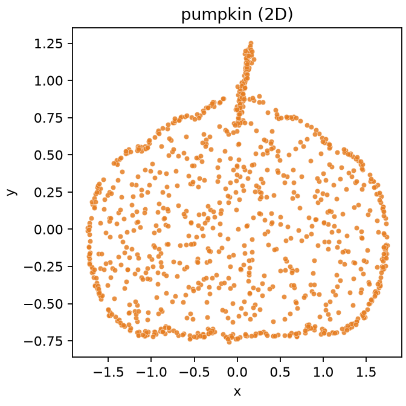

# Skull & Pumpkin point clouds

Synthetic toy dataset: a **skull** silhouette and a **pumpkin** silhouette as 2D point clouds, plus an **8D** two-class table for simple classification demos.

Not real medical / botanical data — parametric contours filled with jittered points.

## Preview

| Skull | Pumpkin |
|-------|---------|
|  |  |

## Files

| Path | Contents |
|------|----------|
| `data/skull_2d.csv` | 1000 points, columns `x,y` |
| `data/pumpkin_2d.csv` | 1000 points, columns `x,y` |
| `data/df8d.csv` | 2000 rows × 8 features (`F01`–`F08`) + `class` |
| `generate.py` | reproducible generator |

### 8D layout

| Class | Shape lives in | Noise lives in |
|-------|----------------|----------------|
| `skull` | `F01`–`F04` (two 2D copies) | `F05`–`F08` |
| `pumpkin` | `F05`–`F08` (two 2D copies) | `F01`–`F04` |

Native planes to plot: skull → `F01`–`F02`, pumpkin → `F05`–`F06`.

## Regenerate

```bash
pip install -r requirements.txt
python generate.py --seed 42 --n 1000
```

Default seed is `42`.

## Load quickly

```python
import pandas as pd

skull = pd.read_csv("data/skull_2d.csv")
pumpkin = pd.read_csv("data/pumpkin_2d.csv")
df = pd.read_csv("data/df8d.csv")
```

## License

MIT — see `LICENSE`.
